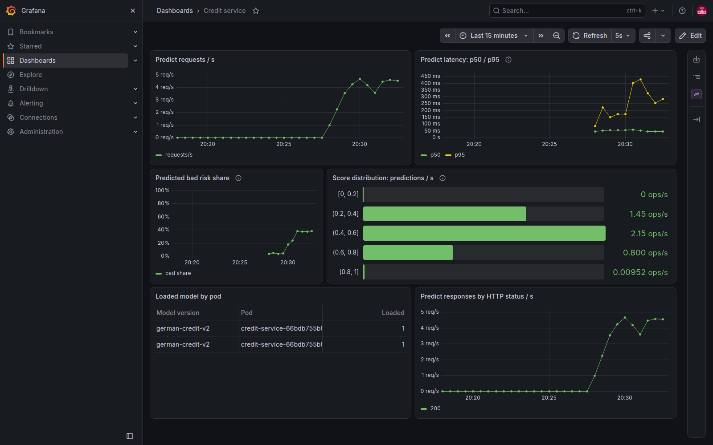

# проект Credit service

Сервис кредитного скоринга: FastAPI, LogisticRegression, PostgreSQL,
DVC/S3, MLflow, Airflow, Prometheus и Grafana.
Инструкция запуска: [README.md](README.md).

## Схема и хранение

~~~mermaid
flowchart LR
    User[Клиент] --> Ingress[Traefik Ingress]
    Ingress --> API[FastAPI]
    API --> DB[(PostgreSQL: журнал)]
    API --> MLflow[MLflow: champion]
    Airflow[Airflow DAG] --> Validate[Pod validate]
    Validate --> Train[Pod train]
    Train --> Gate{promoted}
    Gate -->|true| Rollout[Перезапуск API]
    Validate --> S3[(RustFS: DVC)]
    Train --> S3
    Validate --> MLflow
    Train --> MLflow
    Prometheus[Prometheus] -->|ServiceMonitor: /metrics| API
    Grafana[Grafana] --> Prometheus
    CI[GitHub Actions] --> Registry[GHCR: образ по SHA]
    CI --> API
    CI --> Airflow
~~~

| Что | Где хранится и как найти версию |
| --- | --- |
| Код и настройки | GitHub; Git SHA, Dockerfile и uv.lock |
| Данные | Бакет dvc в RustFS; MD5 в datasets/german_credit_data.csv.dvc и параметре MLflow data_md5 |
| Модели и метрики обучения | MLflow, PVC mlflow-data; имя german-credit, номер версии, run_id и Aliases |
| Docker-образы | GHCR, тег sha-<Git SHA>; при локальной проверке — Docker и kind |
| Журнал запросов | PostgreSQL, таблица predictions; поиск по request_id |
| История задач | Airflow; dag_id, run_id и логи задач |

Хранилища привязаны к локальному kind: удаление кластера удаляет его PVC.
У PostgreSQL в текущем манифесте нет отдельного PVC.

## 1. Платформа одной командой

Добавлены platform/up.sh, RustFS, создание бакета dvc и LF-настройки
.gitattributes. Скрипт создаёт или использует кластер mlpro3, устанавливает
Traefik, metrics-server, мониторинг, MLflow и Airflow, затем проверяет Ingress.
Повторный запуск сохраняет существующий S3 Secret и бакет.

Quickstart сокращён до scripts/quickstart.sh. Он вызывает платформу,
scripts/prepare.py (локальные ключи из Secret, DVC, проверка CSV и первый
champion) и scripts/deploy-local.sh (образ, API, мониторинг, DAG и smoke).
Регистрация runner вынесена в scripts/register-runner.sh и требует
registration token из GitHub.
Полный quickstart.sh проверен на существующем кластере: код выхода 0,
444 секунды, обе реплики API Ready, health/predict и метрика версии доступны.
Существующий champion v1 сохранён, DVC-указатель не изменился; это проверка
повторного запуска, а не свежего клона и нового кластера.
Воспроизведение CSV из Kaggle для пустого S3 сохраняет индекс, NA и LF,
а перед записью проверяет MD5 источника и соответствие текущему указателю.

Платформа была поднята после устранения сетевых ошибок загрузки образов.
Последний завершающий запуск up.sh занял 47 секунд; это не время всей установки.
Отсутствовавший ранее файл [platform/README.md](platform/README.md) добавлен;
в нём указаны версии и источники настроек. Первая попытка запуска Quickstart
на новом кластере `mlpro3-quickstart` была прервана при ожидании Airflow;
этот кластер удалён.

Повторная проверка выполнена из свежего клона коммита `5ce005c` на новом кластере
`mlpro3-quickstart`. Платформа поднялась за 1051 с:
MLflow, Airflow, Grafana и RustFS ответили на проверки, бакет `dvc` создан.
Пустой DVC remote не содержал CSV; скрипт восстановил его из Kaggle и
загрузил в бакет. [Проверка данных](http://mlflow.localhost/#/experiments/1/runs/f6a362638d2044278f0ce2497a348aff)
завершилась, затем создан первый champion v1 с PR-AUC 0.6242:
[run обучения](http://mlflow.localhost/#/experiments/1/runs/3700ab08b3a8445b96da1523ea6e9526).
Docker-образ собран и загружен в kind, Deployment API успешно развернулся:
обе реплики 1/1 Ready. Smoke через Ingress получил `status=ok` и
`german-credit-v1` на `/health`, ответ с версией v1 на `/v1/predict` и
`credit_model_info{model_version="german-credit-v1"} 1.0` на `/metrics`.
В финальном выводе: `Запуск завершён за 1543 с` и `Quickstart exit code: 0`.
Это подтверждает полный Quickstart из свежего клона на новом кластере.

## 2. Метрики и дашборд

Подключены prometheus-fastapi-instrumentator и собственные метрики:
credit_model_info, credit_model_score и credit_model_predictions_total.
ServiceMonitor обращается к именованному порту http. Дашборд поставляется
ConfigMap с grafana_dashboard: "1"; генератор отправляет реальные признаки
из CSV через Ingress.

HTTP-бакеты в секундах: 0.01, 0.025, 0.04, 0.05, 0.075, 0.1, 0.15,
0.2, 0.3, 0.5, 0.75, 1, 2. Основание — сохранённые
[замеры Locust](docs/hw3/locust_10_stats.csv): в прогонах на 1/5/10 пользователей
p50 составляла 44/44/50 мс, p95 — 88/110/160 мс, максимумы — 517–685 мс.
Границы уплотнены вокруг этих значений; старые замеры включают сеть и Ingress,
а новая гистограмма измеряет время внутри приложения, включая аудит в БД.

Score — вероятность bad в диапазоне [0, 1]; бакеты выбраны с шагом 0.1.
На дашборде они объединены в пять интервалов. Это предсказания, не истинные
классы. Метки не содержат request_id или значений признаков.
Метрики модели учитывают успешные ответы после записи аудита.

В Deployment добавлен preStop со sleep 5 — начальная политика ожидания
обновления маршрутизации, не измеренный оптимум. Перезапуск двух реплик
под трафиком дал 896 запросов за 180 секунд и 0 ошибок; версия модели
при этом оставалась v1. Контрольного прогона без preStop не было.

Дашборд под трафиком показывает RPS, p50/p95, распределение score, долю bad
и версии по pod. [Скрин](docs/hw4/dashboard-promotion.png) снят во время
успешного продвижения модели, описанного в разделе 5.

## 3. Данные в DVC и S3

Настроены два remote на один бакет: laptop — http://s3.localhost,
cluster — http://rustfs.mlops:9000. Ключи хоста находятся в игнорируемом
.dvc/config.local; pod получают AWS-переменные из mlops/s3-credentials.

В образ копируются .dvc/config и указатель CSV, включён core.no_scm=true.
Сам CSV, кеш DVC и локальные ключи исключены из Docker-контекста.
Проверены восстановление с пустым кешем и DVC pull внутри Kubernetes.

| Версия CSV | Строк | MD5 |
| --- | ---: | --- |
| Исходная | 1000 | 3086216ff1ff32f7626554e730cccc91 |
| Текущая хорошая | 901 | 75716716a440972dfc0fed80bb7791cc |
| Тестовая плохая | 901 | d3776a7662b5423c2152a84da410493d |

Все эти версии загружены в S3. В текущей хорошей версии удалены строки,
у которых одновременно отсутствуют Saving accounts и Checking account.
Вывод проверки образа credit-service:hw4-dvc:

~~~text
$ docker run --rm --entrypoint ls credit-service:hw4-dvc datasets
german_credit_data.csv.dvc
~~~

Версии данных в бакете DVC на момент проверки:

## 4. Проверка данных

Добавлены две Pandera-схемы в src/credit_service/data.py.
Схема строк проверяет типы, категории, уникальность record_id, если он есть,
и границы: возраст >0 и <120, сумма и срок >0, job 0–3.
Числовые границы согласованы с [контрактом API](src/credit_service/service/app.py),
поэтому наблюдаемые экстремумы CSV 19–75, 250–18424 и 4–72 больше не
останавливают корректные новые выгрузки. Категории остаются ограничениями
текущего учебного набора и [паспорта модели](artifact/metadata.json).

Схема выгрузки требует минимум 800 строк и долю bad в [0.25, 0.35].
800 — выбранный допуск потери не более 20% от исходных 1000 записей;
коридор класса — исходные 30% ±5 процентных пунктов, текущие 32.30% проходят.
Это эмпирические допуски, не доверительные интервалы.

При нарушении создаётся MLflow run с valid=false, сохраняется
failure_cases.csv, CLI возвращает 1. Тесты используют синтетические данные:
проверены хорошие строки, ошибки значений и недостаточный объём.
Для новых границ добавлен тест полной выгрузки с возрастом 76 лет, суммой
20000 и сроком 73. На текущем рабочем дереве `uv run --no-sync ruff check .`
и `uv run --no-sync pytest -q` завершились с кодом 0; в pytest две проверки
пропущены без PostgreSQL. Проверки с PostgreSQL выполняются в CI.

Первоначальная проверка некорректных данных: запуск завершился ошибкой,
тег valid=false.

Проверка плохой выгрузки из Airflow: 901 нарушение, MD5 тестовой версии
и valid=false. Здесь показан Overview запуска, а не содержимое артефакта CSV.

## 5. Airflow и проверенные сценарии

DAG credit_retrain: validate → train → promoted → rollout.
Первые две задачи работают в отдельных pod из образа сервиса, каждая делает
dvc pull -r cluster. Train передаёт JSON через XCom; ShortCircuitOperator
разрешает rollout только при promoted=true. Rollout перезапускает
default/credit-service и ждёт готовности обновлённых реплик.

Расписание — ежедневно в 03:00 по Москве через CronTriggerTimetable,
без start_date. Новый DAG на паузе, одновременно разрешён один запуск.
CI публикует ConfigMap airflow-dags и переменную credit_image.

| Сценарий | Выполненные действия и результат |
| --- | --- |
| Отказ гейта | hw4-gate-rejected: validate/train/promoted успешны, rollout skipped. V2 с PR-AUC 0.6107 получила challenger; champion v1 с 0.6242 сохранился, UID pod не изменились |
| Плохая выгрузка | Сумма кредита умножена на 1000 с сохранением типов и числа строк; dvc push выполнен до публикации указателя. Коммит c1ff679, деплой, запуск hw4-bad-data-c1ff679: validate failed, остальные upstream_failed. MLflow valid=false, 901 нарушение; API продолжил отвечать моделью v1 |
| Восстановление | Хороший указатель возвращён коммитом a9b4390 и задеплоен. hw4-data-restored: validate/train/promoted успешны, rollout skipped; зарегистрирована v4, champion остался v1 |
| Успешное продвижение | `hw4-promotion-20261025`: validate, train, promoted, rollout — success; champion сменился с v1 на v2, API ответил новой версией под трафиком без ошибок генератора |
| Отказ по новому гейту | `hw4-rejection-20261025`: кандидат C=1 / вес bad=1 получил PR-AUC 0.610738; validate/train/promoted — success, rollout — skipped. Champion остался v2, challenger стал v3 |

Плохая выгрузка: validate завершился ошибкой, следующие задачи не выполнялись.

После восстановления данных проверка и обучение снова успешны;
rollout пропущен по решению гейта.

Гейт пересмотрен: кандидат должен улучшить PR-AUC больше чем на 0.01
в абсолютных единицах. Один процентный пункт — выбранный инженерный допуск.
По парному сравнению 50 разбиений выборочное стандартное отклонение разности
PR-AUC равно 0.009859: порог сопоставим с наблюдаемым масштабом колебания
парной разности, а не с размахом оценок одной модели. Допуск выбран
независимо от этой оценки; это не критерий статистической значимости.

Прежний порог 0.24 рассчитывался по размаху качества одной конфигурации
между разбиениями. Такой расчёт не оценивает неопределённость парной разности
двух моделей; рекомендация удалена из evaluate_gate.py. Прежний расчёт
сохранён только как исторический результат и не задаёт текущую политику.

Выполнено новое парное сравнение на 50 одинаковых стратифицированных
разбиениях текущего CSV. Расчёт воспроизводится командой
`uv run --no-sync python -m credit_service.evaluate_gate --data datasets/german_credit_data.csv --splits 50 --output-dir /tmp/credit-gate-analysis`.
Обозначения v3/v5 — конфигурации
C=0.007 / вес bad=1 и C=0.01 / вес bad=2, а не номера текущего реестра.
Средний прирост второй конфигурации — 0.008272, положительный в 39/50 пар,
а больше 0.01 — в 21/50. При seed 42 получены 0.624200 и 0.634330,
прирост 0.010130. Знак прироста меняется, holdout-выборки пересекаются;
эти результаты не доказывают устойчивое превосходство на новых данных.

Новые run записывают data_md5, seed, test_size=0.2, stratified=true и
validation_sha256 — отпечаток упорядоченных индексов и меток holdout.
Гейт требует совпадения всех пяти полей с champion. Несопоставимые или
неполные старые run завершают train ошибкой до обучения, регистрации модели
и смены aliases. В MLflow записываются gate_comparable, promoted и
артефакт gate_result.json с исходными оценками, приростом и порогом.
Новый первый champion создаётся без сравнения при отсутствии alias;
данные старых запусков не дополняются предположениями о split.

В отдельном временном локальном реестре MLflow проверена полная функция
обучения: первый champion C=0.007 / вес bad=1, затем продвижение
C=0.01 / вес bad=2 с приростом 0.010130, затем отказ C=1 / вес bad=1
с PR-AUC 0.610738. После трёх запусков champion остался второй моделью,
challenger стал третьей; все пять полей контекста оценки совпали.
Эта проверка не включает Airflow, Kubernetes и смену версии API под трафиком.

Первые три сценария Airflow в таблице выше относятся к прежнему порогу 0.24.
Новый сценарий продвижения выполнен на образе
`ghcr.io/sunchessun/credit-service:sha-de8c8cd696eef867834c75b1a3b739d89e2b410f`.
Baseline v1 и кандидат v2 имеют одинаковые `data_md5`, `seed`, `test_size`,
`stratified` и `validation_sha256`: [выгрузка MLflow](docs/hw4/promotion-mlflow.json).
PR-AUC вырос с 0.624200 до 0.634330, разность 0.010130 > 0.01.
В [прогоне DAG](http://airflow.localhost/dags/credit_retrain/runs/hw4-promotion-20261025)
все четыре задачи завершились успешно: [граф](docs/hw4/airflow-promotion-graph.png).
Alias `champion`
перешёл на v2: [скрин реестра](docs/hw4/model-registry-promotion.png).
Генератор трафика запущен до DAG и работал во время rollout:
[полный вывод](docs/hw4/traffic-promotion.jsonl). За 360 секунд
выполнено 1649 запросов: 536 ответов v1, 1113 ответов v2, ошибок 0.
Первый ответ v2 — строка 509, последний ответ v1 — строка 564;
после него 1085 ответов подряд получены от v2. Дашборд под этим трафиком
показывает обе реплики с v2 и ответы HTTP 200:

Последующий [прогон отказа](http://airflow.localhost/dags/credit_retrain/runs/hw4-rejection-20261025)
под новой политикой подтвердил, что более слабая модель не меняет champion:
[граф DAG](docs/hw4/airflow-rejection-new-gate.png),
[Aliases после отказа](docs/hw4/model-registry-after-rejection.png),
[метрики и теги MLflow](docs/hw4/rejection-mlflow.json).
После отказа API отвечал v2,
обе реплики Deployment были готовы.

Историческое восстановление сделано обычным коммитом. В отдельном временном
worktree от `c1ff679` выполнены `git revert --no-commit c1ff679` и
`dvc checkout datasets/german_credit_data.csv.dvc`: обе команды завершились
с кодом 0. MD5 восстановленного CSV и указателя совпал:
`75716716a440972dfc0fed80bb7791cc`, строк — 901. История исходного
сценария не переписывалась, новый коммит не создавался.

## 6. CI/CD

Tests выполняет Ruff и pytest с PostgreSQL; build публикует образ в GHCR
по SHA коммита. Ручной deploy работает на self-hosted runner mlpro3-kind:
загружает образ в kind, применяет Secret, БД и API, мониторинг и DAG.
Smoke через Ingress проверяет champion из реестра, осмысленный ответ good.json,
строку predictions по request_id и credit_model_info с версией из health.

[Полный зелёный запуск для c1ff679](https://github.com/SunchesSun/credit-service/actions/runs/38985932015)
подтверждает tests, build, deploy, шаг «мониторинг и DAG» и smoke.
После восстановления данных в кластере проверен образ по SHA a9b4390.

## Пункт задания → доказательство

| Требование | Доказательство / ограничение |
| --- | --- |
| Платформа и Quickstart | [Команды](README.md#quickstart), [up.sh](platform/up.sh), [коммит проверенного клона](https://github.com/SunchesSun/credit-service/commit/5ce005c355d1da4e6ea23a3f956d36f09761cb41), [первый champion нового кластера](http://mlflow.localhost/#/experiments/1/runs/3700ab08b3a8445b96da1523ea6e9526); полный проход за 1543 с, код выхода 0, health/predict/metrics успешны |
| Метрики и дашборд под трафиком | [Скрин Grafana](docs/hw4/dashboard-promotion.png), [ServiceMonitor](k8s/servicemonitor.yaml), [дашборд](k8s/dashboard.yaml) |
| S3 и данные вне образа | [Бакет](docs/hw4/s3-bucket.png), [.dvc/config](.dvc/config), [Dockerfile](Dockerfile); вывод ls выше |
| Pandera и тесты CI | [Тесты](tests/test_data.py), [зелёный CI](https://github.com/SunchesSun/credit-service/actions/runs/38985932015) |
| Ошибки в MLflow | [Run](http://mlflow.localhost/#/experiments/1/runs/e921a6ded4ff44178e1411c2cb4e2c74), [скрин Overview](docs/hw4/pandera-bad-data-artifact.png); открытый CSV на этом скрине не показан |
| DAG: отказ гейта | [Прогон под новым порогом](docs/hw4/airflow-rejection-new-gate.png), [Aliases после отказа](docs/hw4/model-registry-after-rejection.png) |
| DAG: плохие данные | [Граф](docs/hw4/airflow-bad-data.png), [коммит](https://github.com/SunchesSun/credit-service/commit/c1ff679b091a5f3387a1bb0bb76e99334f6943c2) |
| Восстановление | [Скрин](docs/hw4/airflow-data-restored.png), [validate](http://mlflow.localhost/#/experiments/1/runs/59c9e80666694111a50dd8df402ec70d), [train](http://mlflow.localhost/#/experiments/1/runs/cdb4e6c35eb04ab7b89069f0933c9696); исторически обычный коммит a9b4390, отдельная проверка `git revert --no-commit` и `dvc checkout` описана выше |
| Продвижение и смена версии без ошибок | [Граф DAG](docs/hw4/airflow-promotion-graph.png), [Aliases](docs/hw4/model-registry-promotion.png), [дашборд](docs/hw4/dashboard-promotion.png), [вывод генератора](docs/hw4/traffic-promotion.jsonl), [run](http://airflow.localhost/dags/credit_retrain/runs/hw4-promotion-20261025) |
| Полный deploy на своём runner | [GitHub Actions](https://github.com/SunchesSun/credit-service/actions/runs/38985932015) |

Ссылки MLflow локальные: run нового кластера доступны, пока сохранён
`mlpro3-quickstart`; ссылки на run удалённого `mlpro3` больше не открываются.
Дополнительные задания со звёздочкой не заявляются выполненными.

## Ответы на восемь вопросов

1. **Как восстановить код и данные модели N?** В Model registry доступны run_id версии, затем data_md5, параметры обучения, seed, metadata.json и зависимости. Для обучения из Git используется тег mlflow.source.git.commit, если он записан; для pod — SHA образа из логов соответствующего DAG и CI, поскольку в образе нет .git. Для восстановления нужно переключить Git на этот SHA, установить зависимости из uv.lock и выполнить dvc pull по указателю с нужным MD5; автоматическая связь каждого pod-run с Git SHA отдельным тегом сейчас не реализована.

2. **Почему в образе указатели, а не данные?** Указатель фиксирует нужную версию, а CSV скачивается отдельно из S3 перед задачей и не увеличивает образ. Если git push опередит dvc push, новый образ может ссылаться на ещё отсутствующий объект: dvc pull упадёт в validate или train, причина будет в логах Airflow.

3. **Какие проверки бинарные, какие пороговые?** Типы, допустимые категории и уникальность ID проверяются как соответствие контракту; возраст, сумма, срок, объём и доля bad сравниваются с границами. Все проверки в итоге дают успех или ошибку. Границы признаков согласованы с API, а допуски объёма и доли bad обоснованы в пункте 4. Если схема отклонит новую выгрузку, нужно разобрать failure_cases и пересмотреть контракт, а не автоматически менять границы.

4. **Зачем и Pandera, и Pydantic?** Pydantic проверяет отдельный входящий запрос API и его признаки. Pandera проверяет обучающую таблицу, включая target, уникальность записей, объём и распределение класса; эти свойства невозможно проверить по одной заявке.

5. **Почему обучение в отдельном pod и зачем тот же образ?** Так задача получает зависимости проекта из uv.lock, а Airflow остаётся оркестратором и не требует установки ML-библиотек в свой контейнер. Новая модель лежит в MLflow: после изменения champion достаточно перезапуска API, который загрузит alias заново; пересборка нужна при изменении кода или зависимостей.

6. **Какие метрики про что и почему без request_id?** RPS, p50/p95 и HTTP-коды относятся к сервису, версия модели, распределение score и доля предсказанного bad — к модели. Инфраструктуру проверяем через up, состояние Kubernetes и kubectl top; отдельных CPU/RAM-панелей на этом дашборде нет. Request_id почти всегда уникален и создавал бы новую временную серию на каждый запрос; для него есть журнал PostgreSQL.

7. **Что происходит при rollout и зачем preStop?** Kubernetes постепенно создаёт новые pod, ждёт готовности и завершает старые; до готовности новые реплики не обслуживают трафик. Пауза preStop даёт время обновить маршрутизацию перед остановкой процесса. На перезапуске той же модели было 896 запросов без ошибок; без preStop отдельного прогона не было. Отдельный прогон DAG со сменой версии под трафиком приведён в пункте 5.

8. **Какой отказ наиболее вероятен и что делать?** Судя по опыту наиболее вероятный отказ это недоступность реестра образов или S3 из-за сети, DNS или прокси. Он обнаружится при следующем скачивании в deploy/DAG; фиксированное время обнаружения и автоматические алерты не настроены. При отказе следует проверить Events pod, логи dvc pull/контейнера, доступ к endpoint и настройки сети; работающий champion при отказе validate продолжает обслуживать API.

## Переделки

| Пункт фидбека | Что исправлено | Коммит или прогон; ограничение |
| --- | --- | --- |
| Порог 0.24 исключал успешное продвижение | Гейт снижен до 0.01 и требует одинакового контекста оценки. В парном сравнении std разности PR-AUC — 0.009859; в выбранном прогоне прирост — 0.010130 | [Коммит de8c8cd](https://github.com/SunchesSun/credit-service/commit/de8c8cd696eef867834c75b1a3b739d89e2b410f), [прогон DAG](http://airflow.localhost/dags/credit_retrain/runs/hw4-promotion-20261025), [граф](docs/hw4/airflow-promotion-graph.png), [Aliases](docs/hw4/model-registry-promotion.png), [дашборд](docs/hw4/dashboard-promotion.png), [генератор](docs/hw4/traffic-promotion.jsonl) |
| Quickstart проверен только на живом кластере; ссылка на `platform/README.md` была битой | Скрипт Quickstart и описание платформы добавлены. Полный запуск из свежего клона на новом `mlpro3-quickstart` завершился за 1543 с с кодом 0; две реплики API готовы, health/predict/metrics ответили | [Коммит проверенного клона 5ce005c](https://github.com/SunchesSun/credit-service/commit/5ce005c355d1da4e6ea23a3f956d36f09761cb41), [коммит описания платформы 850fc0a](https://github.com/SunchesSun/credit-service/commit/850fc0ae765ca28b696b0629184572ed2fad07c4), [run первого champion](http://mlflow.localhost/#/experiments/1/runs/3700ab08b3a8445b96da1523ea6e9526) |
| Откат плохой выгрузки сделан обычным коммитом вместо `git revert` и `dvc checkout` | В отдельном worktree проверены `git revert --no-commit c1ff679` и `dvc checkout`; MD5 восстановленного указателя совпал. Это проверка команд, не новый сценарий Airflow | Исторический [коммит a9b4390](https://github.com/SunchesSun/credit-service/commit/a9b4390c72f885c2003ab3499c1f97f8c04237c9) и [граф прогона](docs/hw4/airflow-data-restored.png) относятся к прежнему способу восстановления; прогона после `git revert` и `dvc checkout` нет |
| Границы Pandera равнялись min/max CSV, поэтому возраст 76 отклонялся | Границы схемы согласованы с API: возраст >0 и <120, сумма и срок >0; добавлен тест выгрузки с возрастом 76. Свежий Quickstart проверил исходный CSV, но сценарий с возрастом 76 через DAG не запускался | [Коммит схемы 5ce005c](https://github.com/SunchesSun/credit-service/commit/5ce005c355d1da4e6ea23a3f956d36f09761cb41), [коммит теста 5415f20](https://github.com/SunchesSun/credit-service/commit/5415f200b0f6f7f06f1f52cf0ce8999d72c470a2) |

Ссылки на Airflow/MLflow ведут в локальный кластер. Исходный `mlpro3`
удалён перед проверкой с нуля; сейчас работает `mlpro3-quickstart` с первым
champion v1. Ссылки на прогоны MLflow/Airflow удалённого кластера больше
не открываются, но сохранённые скриншоты и выгрузки находятся в `docs/hw4`.
У PostgreSQL нет отдельного PVC, поэтому прежний аудит запросов в БД
недоступен.

## Журнал проблем

| Проблема | Причина и выполненное исправление |
| --- | --- |
| Kubernetes API недоступен с хоста | Пересечение маршрутов Docker и eth0; добавлен маршрут к проверенному адресу узла |
| Helm: context deadline exceeded, ImagePullBackOff | Loopback-прокси хоста оказался недоступен внутри kind; up.sh исключает его при создании узла. Отдельные TLS/DNS-сбои обойдены загрузкой образов на хосте и kind load |
| Python: имя s3.localhost не разрешается | Имена платформы добавлены в /etc/hosts |
| Первый локальный DAG: ErrImagePull | Запуск опередил завершение kind load; повторный запуск после загрузки образа прошёл |
| API: password authentication failed | Secret CI отличался от пароля существующей БД; пароль роли однократно согласован без пересоздания |
| Pandera отклонила выгрузку | Тестовая ошибка единиц суммы кредита; хороший указатель восстановлен, повторный validate успешен |
