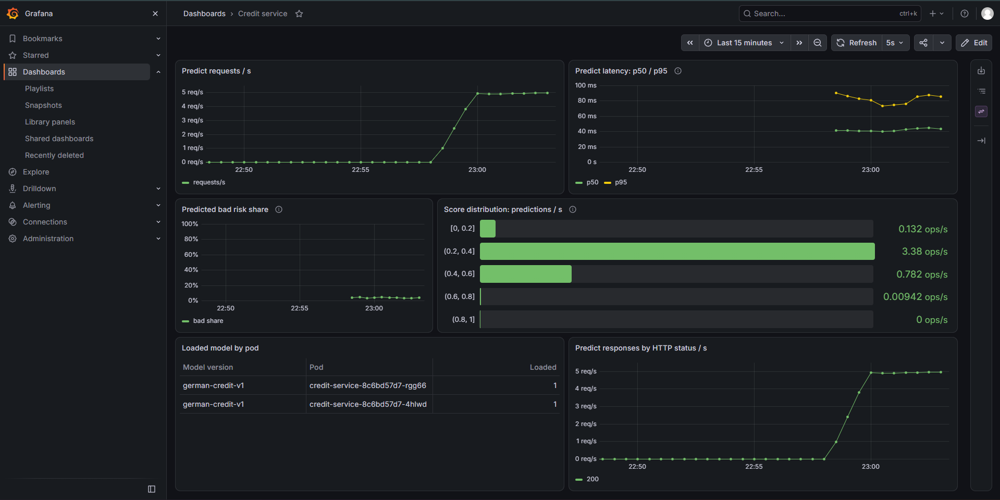
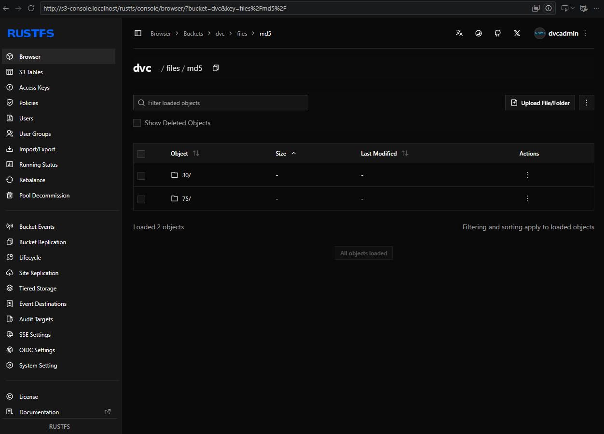
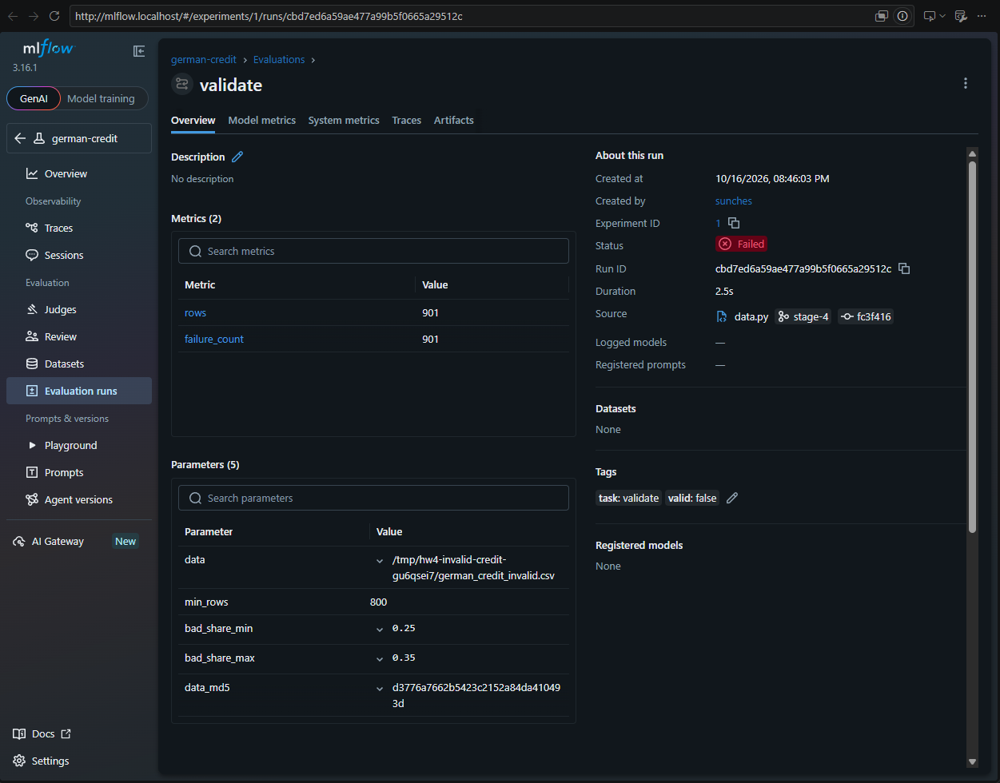
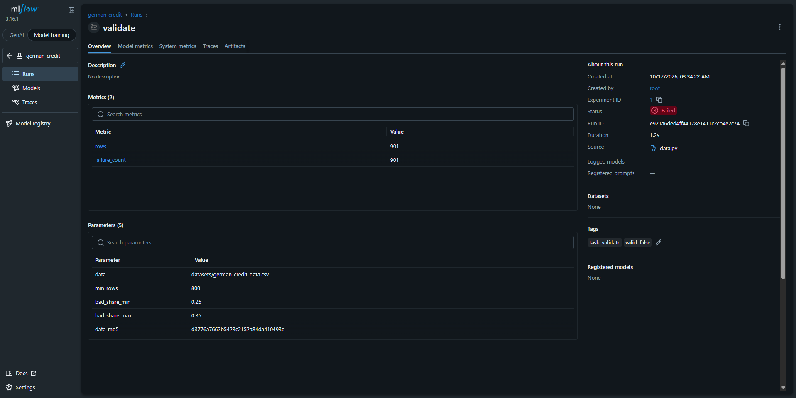
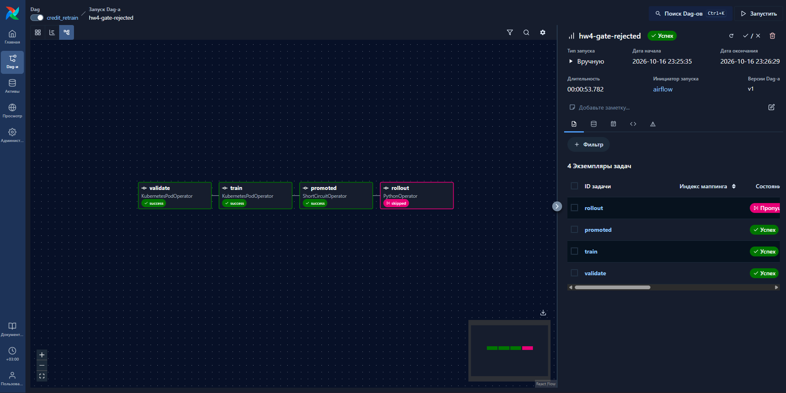
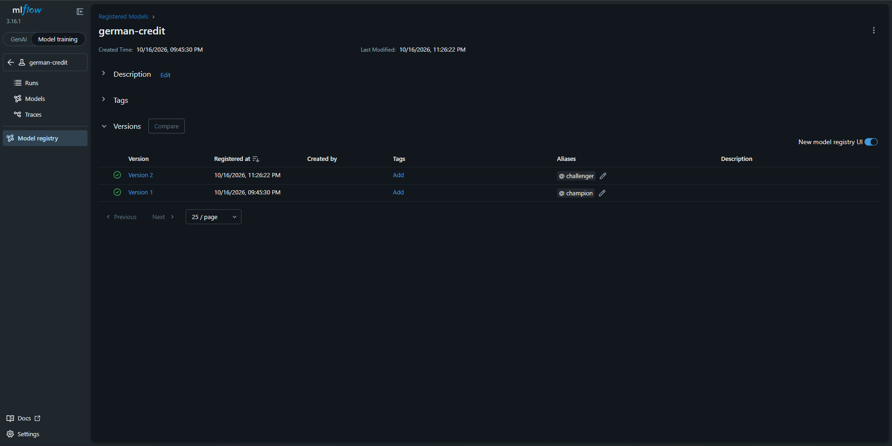
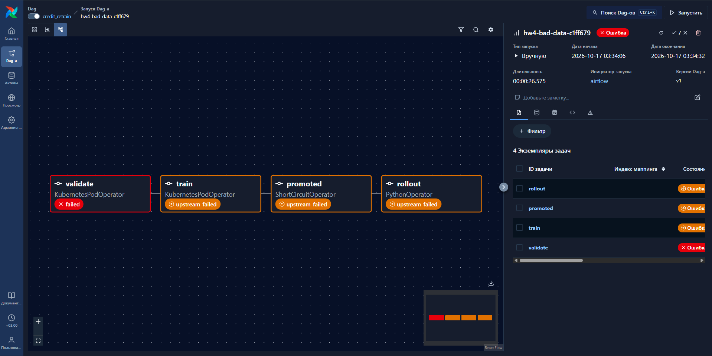
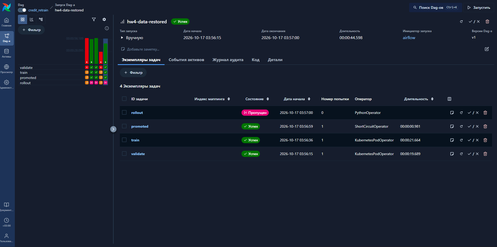

# проект Credit service

Сервис кредитного скоринга: FastAPI, LogisticRegression, PostgreSQL,
DVC/S3, MLflow, Airflow, Prometheus и Grafana.
Инструкция запуска: [README.md](README.md).

## Схема и хранение

~~~mermaid
flowchart LR
    User[Клиент] --> Ingress[Traefik Ingress]
    Ingress --> API[FastAPI]
    API --> DB[(PostgreSQL: журнал)]
    API --> MLflow[MLflow: champion]
    Airflow[Airflow DAG] --> Validate[Pod validate]
    Validate --> Train[Pod train]
    Train --> Gate{promoted}
    Gate -->|true| Rollout[Перезапуск API]
    Validate --> S3[(RustFS: DVC)]
    Train --> S3
    Validate --> MLflow
    Train --> MLflow
    Prometheus[Prometheus] -->|ServiceMonitor: /metrics| API
    Grafana[Grafana] --> Prometheus
    CI[GitHub Actions] --> Registry[GHCR: образ по SHA]
    CI --> API
    CI --> Airflow
~~~

| Что | Где хранится и как найти версию |
| --- | --- |
| Код и настройки | GitHub; Git SHA, Dockerfile и uv.lock |
| Данные | Бакет dvc в RustFS; MD5 в datasets/german_credit_data.csv.dvc и параметре MLflow data_md5 |
| Модели и метрики обучения | MLflow, PVC mlflow-data; имя german-credit, номер версии, run_id и Aliases |
| Docker-образы | GHCR, тег sha-<Git SHA>; при локальной проверке — Docker и kind |
| Журнал запросов | PostgreSQL, таблица predictions; поиск по request_id |
| История задач | Airflow; dag_id, run_id и логи задач |

Хранилища привязаны к локальному kind: удаление кластера удаляет его PVC.
У PostgreSQL в текущем манифесте нет отдельного PVC.

## 1. Платформа одной командой

Добавлены platform/up.sh, RustFS, создание бакета dvc и LF-настройки
.gitattributes. Скрипт создаёт или использует кластер mlpro3, устанавливает
Traefik, metrics-server, мониторинг, MLflow и Airflow, затем проверяет Ingress.
Повторный запуск сохраняет существующий S3 Secret и бакет.

Quickstart сокращён до scripts/quickstart.sh. Он вызывает платформу,
scripts/prepare.py (локальные ключи из Secret, DVC, проверка CSV и первый
champion) и scripts/deploy-local.sh (образ, API, мониторинг, DAG и smoke).
Регистрация runner вынесена в scripts/register-runner.sh и требует
registration token из GitHub; коммиты и git push скрипты не выполняют.
Полный quickstart.sh проверен на существующем кластере: код выхода 0,
444 секунды, обе реплики API Ready, health/predict и метрика версии доступны.
Существующий champion v1 сохранён, DVC-указатель не изменился; это проверка
повторного запуска, а не свежего клона и нового кластера.
Воспроизведение CSV из Kaggle для пустого S3 сохраняет индекс, NA и LF,
а перед записью проверяет MD5 источника и соответствие текущему указателю.

Платформа была поднята после устранения сетевых ошибок загрузки образов.
Последний завершающий запуск up.sh занял 47 секунд; это не время всей установки.
Полный запуск проекта с нуля по итоговому README не измерен и не заявляется
проверенным. Закреплённые версии и источники настроек: [platform/README.md](platform/README.md).

## 2. Метрики и дашборд

Подключены prometheus-fastapi-instrumentator и собственные метрики:
credit_model_info, credit_model_score и credit_model_predictions_total.
ServiceMonitor обращается к именованному порту http. Дашборд поставляется
ConfigMap с grafana_dashboard: "1"; генератор отправляет реальные признаки
из CSV через Ingress.

HTTP-бакеты в секундах: 0.01, 0.025, 0.04, 0.05, 0.075, 0.1, 0.15,
0.2, 0.3, 0.5, 0.75, 1, 2. Основание — сохранённые
[замеры Locust](docs/hw3/locust_10_stats.csv): в прогонах на 1/5/10 пользователей
p50 составляла 44/44/50 мс, p95 — 88/110/160 мс, максимумы — 517–685 мс.
Границы уплотнены вокруг этих значений; старые замеры включают сеть и Ingress,
а новая гистограмма измеряет время внутри приложения, включая аудит в БД.

Score — вероятность bad в диапазоне [0, 1]; бакеты выбраны с шагом 0.1.
На дашборде они объединены в пять интервалов. Это предсказания, не истинные
классы. Метки не содержат request_id или значений признаков.
Метрики модели учитывают успешные ответы после записи аудита.

В Deployment добавлен preStop со sleep 5 — начальная политика ожидания
обновления маршрутизации, не измеренный оптимум. Перезапуск двух реплик
под трафиком дал 896 запросов за 180 секунд и 0 ошибок; версия модели
при этом оставалась v1. Контрольного прогона без preStop не было.

Дашборд под трафиком: RPS, p50/p95, распределение score, доля bad и версии по pod.

## 3. Данные в DVC и S3

Настроены два remote на один бакет: laptop — http://s3.localhost,
cluster — http://rustfs.mlops:9000. Ключи хоста находятся в игнорируемом
.dvc/config.local; pod получают AWS-переменные из mlops/s3-credentials.

В образ копируются .dvc/config и указатель CSV, включён core.no_scm=true.
Сам CSV, кеш DVC и локальные ключи исключены из Docker-контекста.
Проверены восстановление с пустым кешем и DVC pull внутри Kubernetes.

| Версия CSV | Строк | MD5 |
| --- | ---: | --- |
| Исходная | 1000 | 3086216ff1ff32f7626554e730cccc91 |
| Текущая хорошая | 901 | 75716716a440972dfc0fed80bb7791cc |
| Тестовая плохая | 901 | d3776a7662b5423c2152a84da410493d |

Все эти версии загружены в S3. В текущей хорошей версии удалены строки,
у которых одновременно отсутствуют Saving accounts и Checking account.
Вывод проверки образа credit-service:hw4-dvc:

~~~text
$ docker run --rm --entrypoint ls credit-service:hw4-dvc datasets
german_credit_data.csv.dvc
~~~

Версии данных в бакете DVC на момент проверки:

## 4. Проверка данных

Добавлены две Pandera-схемы в src/credit_service/data.py.
Схема строк проверяет типы, категории, уникальность record_id, если он есть,
и диапазоны: возраст 19–75, сумма 250–18424, срок 4–72, job 0–3.
Границы и категории взяты из обеих версий CSV и
[паспорта исходной модели](artifact/metadata.json); это ограничения
учебной выгрузки, а не универсальные правила кредитования.

Схема выгрузки требует минимум 800 строк и долю bad в [0.25, 0.35].
800 — выбранный допуск потери не более 20% от исходных 1000 записей;
коридор класса — исходные 30% ±5 процентных пунктов, текущие 32.30% проходят.
Это эмпирические допуски, не доверительные интервалы.

При нарушении создаётся MLflow run с valid=false, сохраняется
failure_cases.csv, CLI возвращает 1. Тесты используют синтетические данные:
проверены хорошие строки, ошибки значений и недостаточный объём.
Последняя локальная проверка: Ruff без ошибок, pytest — 45 passed / 2 skipped
без DATABASE_URL; проверки с PostgreSQL выполняются в CI.

Первоначальная проверка некорректных данных: запуск завершился ошибкой,
тег valid=false.

Проверка плохой выгрузки из Airflow: 901 нарушение, MD5 тестовой версии
и valid=false. Здесь показан Overview запуска, а не содержимое артефакта CSV.

## 5. Airflow и проверенные сценарии

DAG credit_retrain: validate → train → promoted → rollout.
Первые две задачи работают в отдельных pod из образа сервиса, каждая делает
dvc pull -r cluster. Train передаёт JSON через XCom; ShortCircuitOperator
разрешает rollout только при promoted=true. Rollout перезапускает
default/credit-service и ждёт готовности обновлённых реплик.

Расписание — ежедневно в 03:00 по Москве через CronTriggerTimetable,
без start_date. Новый DAG на паузе, одновременно разрешён один запуск.
CI публикует ConfigMap airflow-dags и переменную credit_image.

| Сценарий | Выполненные действия и результат |
| --- | --- |
| Отказ гейта | hw4-gate-rejected: validate/train/promoted успешны, rollout skipped. V2 с PR-AUC 0.6107 получила challenger; champion v1 с 0.6242 сохранился, UID pod не изменились |
| Плохая выгрузка | Сумма кредита умножена на 1000 с сохранением типов и числа строк; dvc push выполнен до публикации указателя. Коммит c1ff679, деплой, запуск hw4-bad-data-c1ff679: validate failed, остальные upstream_failed. MLflow valid=false, 901 нарушение; API продолжил отвечать моделью v1 |
| Восстановление | Хороший указатель возвращён коммитом a9b4390 и задеплоен. hw4-data-restored: validate/train/promoted успешны, rollout skipped; зарегистрирована v4, champion остался v1 |
| Успешное продвижение | Не выполнено; нет подтверждения смены версии через Airflow под трафиком |

Отказ гейта: первые три задачи успешны, rollout пропущен.

Состояние реестра после этого сценария: v1 — champion, v2 — challenger.

Плохая выгрузка: validate завершился ошибкой, следующие задачи не выполнялись.

После восстановления данных проверка и обучение снова успешны;
rollout пропущен по решению гейта.

Гейт сохранён: PR-AUC кандидата должна превысить champion больше чем на 0.24.
Основание — [эксперимент чувствительности к разбиению](docs/hw3/gate_stability/summary.json):
максимальный наблюдавшийся диапазон PR-AUC базовой конфигурации 0.2235047,
округление вверх до сотых и запас 0.01 дают 0.24.
В сохранённых экспериментах конфигурации v3 и v5 означают соответственно
C=0.007 / вес bad=1 и C=0.01 / вес bad=2, а не номера текущего реестра.
Это строгая эвристика по разбросу одной модели, не тест значимости парной
разности; при champion 0.6242 нужен результат выше 0.8642.
Порог оставлен по решению пользователя. Восстановление сделано обычным
коммитом, а не командой git revert, требуемой заданием.

## 6. CI/CD

Tests выполняет Ruff и pytest с PostgreSQL; build публикует образ в GHCR
по SHA коммита. Ручной deploy работает на self-hosted runner mlpro3-kind:
загружает образ в kind, применяет Secret, БД и API, мониторинг и DAG.
Smoke через Ingress проверяет champion из реестра, осмысленный ответ good.json,
строку predictions по request_id и credit_model_info с версией из health.

[Полный зелёный запуск для c1ff679](https://github.com/SunchesSun/credit-service/actions/runs/38985932015)
подтверждает tests, build, deploy, шаг «мониторинг и DAG» и smoke.
После восстановления данных в кластере проверен образ по SHA a9b4390.

## Пункт задания → доказательство

| Требование | Доказательство / ограничение |
| --- | --- |
| Платформа и Quickstart | [Команды](README.md#quickstart), [up.sh](platform/up.sh); полного замера с нуля нет |
| Метрики и дашборд под трафиком | [Скрин Grafana](docs/hw4/dashboard.png), [ServiceMonitor](k8s/servicemonitor.yaml), [дашборд](k8s/dashboard.yaml) |
| S3 и данные вне образа | [Бакет](docs/hw4/s3-bucket.png), [.dvc/config](.dvc/config), [Dockerfile](Dockerfile); вывод ls выше |
| Pandera и тесты CI | [Тесты](tests/test_data.py), [зелёный CI](https://github.com/SunchesSun/credit-service/actions/runs/38985932015) |
| Ошибки в MLflow | [Run](http://mlflow.localhost/#/experiments/1/runs/e921a6ded4ff44178e1411c2cb4e2c74), [скрин Overview](docs/hw4/pandera-bad-data-artifact.png); открытый CSV на этом скрине не показан |
| DAG: отказ гейта | [Граф](docs/hw4/airflow-gate-rejected.png), [Aliases v1/v2 на момент проверки](docs/hw4/model-registry-aliases.png) |
| DAG: плохие данные | [Граф](docs/hw4/airflow-bad-data.png), [коммит](https://github.com/SunchesSun/credit-service/commit/c1ff679b091a5f3387a1bb0bb76e99334f6943c2) |
| Восстановление | [Скрин](docs/hw4/airflow-data-restored.png), [validate](http://mlflow.localhost/#/experiments/1/runs/59c9e80666694111a50dd8df402ec70d), [train](http://mlflow.localhost/#/experiments/1/runs/cdb4e6c35eb04ab7b89069f0933c9696); обычный коммит a9b4390 вместо git revert |
| Продвижение и смена версии без ошибок | Не предъявлено; проверен только перезапуск той же модели под трафиком |
| Полный deploy на своём runner | [GitHub Actions](https://github.com/SunchesSun/credit-service/actions/runs/38985932015) |

Ссылки MLflow локальные: работают, пока сохранён кластер и его хранилища.
Дополнительные задания со звёздочкой не заявляются выполненными.

## Ответы на восемь вопросов

1. **Как восстановить код и данные модели N?** В Model registry run_id версии, затем data_md5, параметры обучения, seed, metadata.json и зависимости. Для обучения из Git использую тег mlflow.source.git.commit, если он записан; для pod — SHA образа из логов соответствующего DAG и CI, поскольку в образе нет .git. Переключаю Git на этот SHA, устанавливаю uv.lock и выполняю dvc pull по указателю с нужным MD5; автоматическая связь каждого pod-run с Git SHA отдельным тегом сейчас не реализована.

2. **Почему в образе указатели, а не данные?** Указатель фиксирует нужную версию, а CSV скачивается отдельно из S3 перед задачей и не увеличивает образ. Если git push опередит dvc push, новый образ может ссылаться на ещё отсутствующий объект: dvc pull упадёт в validate или train, причина будет в логах Airflow.

3. **Какие проверки бинарные, какие пороговые?** Типы, допустимые категории и уникальность ID проверяются как соответствие контракту; возраст, сумма, срок, объём и доля bad сравниваются с границами. Все проверки в итоге дают успех или ошибку, но числовые допуски требуют обоснования по данным, приведённого в пункте 4. Слишком строгие границы остановят корректную новую выгрузку и переобучение, поэтому нужно разбирать failure_cases, а не автоматически расширять схему.

4. **Зачем и Pandera, и Pydantic?** Pydantic проверяет отдельный входящий запрос API и его признаки. Pandera проверяет обучающую таблицу, включая target, уникальность записей, объём и распределение класса; эти свойства невозможно проверить по одной заявке.

5. **Почему обучение в отдельном pod и зачем тот же образ?** Так задача получает зависимости проекта из uv.lock, а Airflow остаётся оркестратором и не требует установки ML-библиотек в свой контейнер. Новая модель лежит в MLflow: после изменения champion достаточно перезапуска API, который загрузит alias заново; пересборка нужна при изменении кода или зависимостей.

6. **Какие метрики про что и почему без request_id?** RPS, p50/p95 и HTTP-коды относятся к сервису, версия модели, распределение score и доля предсказанного bad — к модели. Инфраструктуру проверяем через up, состояние Kubernetes и kubectl top; отдельных CPU/RAM-панелей на этом дашборде нет. Request_id почти всегда уникален и создавал бы новую временную серию на каждый запрос; для него есть журнал PostgreSQL.

7. **Что происходит при rollout и зачем preStop?** Kubernetes постепенно создаёт новые pod, ждёт готовности и завершает старые; до готовности новые реплики не обслуживают трафик. Пауза preStop даёт время обновить маршрутизацию перед остановкой процесса. На перезапуске той же модели было 896 запросов без ошибок; без preStop отдельного прогона не было, а смена версии через DAG ещё не проверена.

8. **Какой отказ наиболее вероятен и что делать?** Судя по опыту наиболее вероятный отказ это недоступность реестра образов или S3 из-за сети, DNS или прокси. Он обнаружится при следующем скачивании в deploy/DAG; фиксированное время обнаружения и автоматические алерты не настроены. Проверю Events pod и логи dvc pull/контейнера, затем доступ к endpoint и настройки сети; работающий champion при отказе validate продолжает обслуживать API.

## Журнал проблем и переделки

| Проблема | Причина и выполненное исправление |
| --- | --- |
| Kubernetes API недоступен с хоста | Пересечение маршрутов Docker и eth0;  добавил маршрут к проверенному адресу узла |
| Helm: context deadline exceeded, ImagePullBackOff | Loopback-прокси хоста оказался недоступен внутри kind; up.sh исключает его при создании узла. Отдельные TLS/DNS-сбои обошел загрузкой образов на хосте и kind load |
| Python: имя s3.localhost не разрешается | Имена платформы добавлены в /etc/hosts |
| Первый локальный DAG: ErrImagePull | Запуск опередил завершение kind load; повторный запуск после загрузки образа прошёл |
| API: password authentication failed | Secret CI отличался от пароля существующей БД; пароль роли однократно согласован без пересоздания |
| Pandera отклонила выгрузку | Тестовая ошибка единиц суммы кредита; хороший указатель восстановлен, повторный validate успешен |
